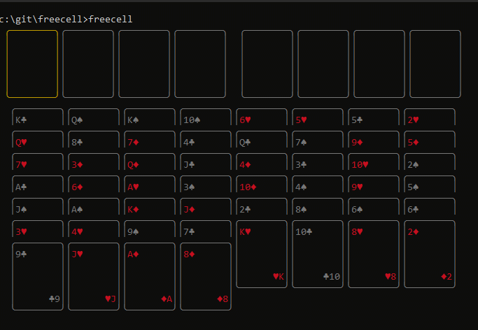

# freecell

Versão CLI do jogo Freecell, desenvolvido com React and [ink](https://github.com/vadimdemedes/ink), e inspirado [nessa versão do jogo Paciênia](https://github.com/zephraph/solitaire)



## Como jogar

Requer Node.js 18 ou superior.

```
npx freecell
```

Use as setas `← ↑ → ↓` para navegar e `enter` (ou espaço) para selecionar e mover as cartas.
Cada partida recebe um baralho novo.

## Desenvolvimento

```
npm install
npm start
npm test
```
